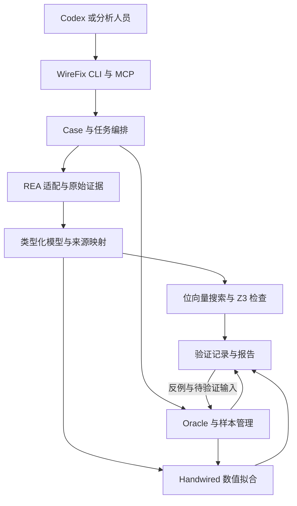

# WireFix 逆向行为建模与验证工具实施方案

版本：1.0。编写日期：2026 年 10 月 19 日。用途：交给 Codex 作为新项目的实施规格。

WireFix 是本方案的工作名称，CLI 暂定为 `wirefix`。它是一个独立于上游的本地逆向分析扩展：通过 REA 获取程序证据，建立受限的可执行行为模型，搜索简化表达式、拟合数值参数、寻找行为差异，并输出可复现的验证结果。

本包是开发规格与验收材料，不是已实现的软件。所有 `wirefix` 命令、MCP 工具名和新增接口均为待实现契约；上游现有接口在文中另行标明。先阅读本文件，再阅读 `docs/SEMANTICS.md`、`docs/INTERFACES.md` 和 `TASKS.md`。`CODEX_START.md` 可直接作为 Codex 的首条任务。

## 1. 产品决策

### 1.1 建设目标

让逆向人员能够完成下面的工作闭环：

1. 找到一个值得分析的函数、表达式或数值接口。
2. 查看原始证据，明确输入、输出和未知条件。
3. 建立一个能运行的候选解释。
4. 用样本、原程序调用或精确模型检查寻找反例。
5. 导出简化函数、适用范围、差分用例和分析报告。

首版聚焦函数级任务。产品的主要产物是带证据的行为说明、可执行候选和回归测试。分析功能首先通过 CLI 与 MCP 提供，Codex 可以直接调用；浏览器工作台在分析链路通过验收后加入。

### 1.2 对两个参考项目的使用方式

| 项目 | 已核查的相关基础 | 本方案的使用方式 |
| --- | --- | --- |
| REA | 本地 CLI/MCP、多种分析后端、函数档案、Evidence 和会话导出；Ghidra 路线已有 high-p-code 值流观察 | 经公开 MCP 与便携 Evidence bundle 接入；优先复用采集、定位和证据，不 fork 整个平台 |
| Handwired | 手工构建数值电路、FP32 执行、反向传播及受限程序搜索实验 | 固定源码提交，封装为数值模型与参数拟合后端 |
| Z3 | 官方 TypeScript/WASM 绑定及位向量求解 | 在独立进程中检查两个受支持模型的等价性，或生成模型反例 |

来源：[S1](https://github.com/morluto/rea)、[S2](https://github.com/morluto/rea/blob/main/docs/native-investigation.md)、[S3](https://github.com/chenglou/handwired/blob/main/docs/execution-model.md)、[S4](https://github.com/Z3Prover/z3/blob/master/src/api/js/PUBLISHED_README.md)。完整来源索引见 `docs/SOURCES.md`。

当前公开文档不等于已安装发布包的能力清单。M0 必须固定实际依赖、记录提交与包版本、获取真实工具 schema。不得假设 `main` 上的功能已经存在于本地 REA。

### 1.3 相对 REA 的新增价值

REA 的函数比较包含对伪代码和汇编文本的比较，其文档明确限制了这些结果的语义含义。本方案增加可执行函数契约、原程序样本协议、受限候选合成、数值参数优化，以及模型检查与目标回放之间的对应关系。[S5](https://github.com/morluto/rea/blob/main/docs/mcp-contracts.md)

必须保留两个不同问题：

- **两个模型是否在指定输入域等价？** 由精确解释器、穷举或 SMT 检查回答。
- **模型是否正确描述原程序？** 由来源、输入绑定、采集完整度和独立原程序回放提供证据。

第一项成立不会自动使第二项成立。

## 2. 用户场景和工具范围

### 2.1 首版必须完成的四个场景

| 场景 | 用户输入 | 必须输出 |
| --- | --- | --- |
| 局部表达式简化 | 一段受支持的位向量模型，或可受限提升的 REA 函数值流 | 更小的候选表达式、所选输出的依赖、模型检查结果 |
| 数值行为恢复 | 具有明确类型的输入输出样本，可选可调用 Oracle | 模板、参数、误差、留出集结果、可执行数值模型 |
| 行为差分 | 两个模型，或两个显式可调用的数值接口 | 区分输入、两侧观测、适用条件和可复现测试 |
| 分析结果交付 | 一个完成或部分完成的分析 case | 自包含报告、模型、测试、原始证据引用、未确定事项 |

### 2.2 第一版的准确边界

**精确位向量通道：** Bool 与 8/16/32/64 位整数；有类型的纯表达式 DAG；固定宽度加减乘、位运算、移位、比较、扩展、截取、拼接和纯值选择。详细操作表以 `docs/SEMANTICS.md` 为准。

**数值通道：** 有限 FP32 输入和明确模板的参数恢复；首批模板为 affine、固定边界的 affine-clamp、固定分段点的 piecewise-affine。数值参考执行器明确每一步 FP32 舍入；Handwired 的梯度用于优化，不用于证明舍入语义。

**输入来源：** 手工编写的模型、明确标为样本的数据集、REA portable bundle，以及固定版本 REA 的 live MCP 连接。

**原生代码范围：** 优先接入 REA/Ghidra 已有的结构化值流。首个可发布原生通道支持完整定义链的直线标量表达式。无环多块函数只有在分支方向、入边槽位、phi 绑定和完整度均可验证时才可启用。缺字段必须返回 `unsupported`；不得以“先猜一个条件”补成可证明模型。

**范围声明：** 从完整受支持表示导入得到 `scope.kind=exported_model`；局部定义链切片为 `expression`；特定轨迹模型为 `trace_slice`；基于样本建立的假设为 `behavior_model`。来源类型不能自动升级为原二进制全函数等价。

以下能力列入后续阶段：任意内存/指针别名、跨函数自动内联与副作用、通用循环、并发、动态间接跳转、完整浮点形式化语义、任意 JS/Electron 执行、通用脱壳和虚拟机去混淆。首版对相关边界应给出具体未支持原因。

### 2.3 后续工具路线

| 方向 | 复用组件 | 新增能力 | 开始条件 |
| --- | --- | --- | --- |
| 协议和文件字段关系 | Oracle、候选搜索、证据和反例 | 字段分段、字节序、变长结构、校验关系候选 | 标量行为闭环稳定 |
| 状态机恢复 | Case、场景数据、主动查询 | 可重置接口、自动机学习、区分序列 | 有确定的 reset 与序列观测契约 |
| 更复杂的混淆简化 | BV IR、Z3、切片 | 重写规则、候选词汇、约束搜索扩展 | 现有操作的语义回归完整 |
| UI 与动态行为辨识 | 数值后端、时间序列 | 状态更新模型、采样时钟和长序列验证 | 单步拟合和长期回放分开计分 |
| Ghidra/IDA 界面插件 | MCP、任务和报告接口 | 选区、跳转、建议注释、结果面板 | CLI/MCP 已有真实端到端证据 |
| 主动测试助手 | 候选集合、Oracle | 模型分歧排序、覆盖与边界反馈 | 同调用预算的基线评测 |

## 3. 系统架构



### 3.1 技术栈

| 层 | 决定 | 理由与限制 |
| --- | --- | --- |
| 主运行时 | Node 24.x，满足 REA 当前 Node 24 分支要求；M0 锁精确补丁版本 | 与 REA 和 Handwired 的 TS 生态衔接 |
| 语言与工作区 | TypeScript strict、ESM、npm workspaces、提交 lockfile | 一个主要语言和依赖体系 |
| 精确执行 | 自建小型 BigInt 解释器 | 每步按位宽归一化，禁止经 Number 中转 |
| 约束求解 | 官方 `z3-solver`，每个子进程串行处理一个任务 | 隔离求解超时、WASM 和后台线程 |
| 数值执行 | 自有 FP32 参考执行器 + 固定提交的 Handwired 适配器 | 支持逐操作差分与后端替换 |
| 模型/API 契约 | JSON Schema 2020-12，生成或校验 TS 类型 | 结构 schema 与语义 validator 分层 |
| 首版存储 | 每 case 的 JSON manifest、JSONL 数据、不可变文件与 SHA-256 | 单写者队列、原子发布；暂不需要数据库服务器 |
| CLI/MCP | 共享 application service；MCP 使用 M0 核验过的官方 SDK | 不让两个入口形成两套实现 |
| 测试 | Vitest、属性测试、源代码可控的 C/JS fixture、真实 REA/Ghidra 集成 | 不以 mock 替代原生集成验收 |
| 可选工作台 | React + Vite，本地只读报告与任务界面 | M6 后实现；核心计算留在本地服务进程 |

本方案不要求 Python 服务、GPU、模型微调或付费 LLM API。Codex 是可选的分析交互入口；确定性核心和回归测试必须在没有 LLM 的环境运行。

Z3 官方 JS 绑定包含线程与并发约束，因此 Worker 不得在同一个模块异步求解期间再调用同步 Z3 API。正常退出执行支持的线程清理；超时由父进程终止其拥有的整个 Worker。[S4]

### 3.2 建议代码目录

以下为未来实现仓库的目录；本实施包中的文档可以复制到该仓库的 `spec/`。

```text
apps/cli/
apps/mcp/
apps/workbench/                 # 后续界面阶段
packages/contracts/
packages/case-store/
packages/rea-adapter/
packages/model-ir/
packages/exact-evaluator/
packages/synthesis/
packages/oracle/
packages/numeric-models/
packages/handwired-adapter/
packages/verification/
packages/reporting/
workers/z3/
workers/numeric/
vendor/handwired/
tests/unit/
tests/property/
tests/integration/
tests/e2e/
fixtures/source/
docs/adr/
artifacts/acceptance/
```

`verification` 不依赖 LLM、UI 或某个反编译器。`rea-adapter` 不 import REA 私有 `dist` 路径。各包只能通过公开契约交换数据。

## 4. REA 接入设计

### 4.1 两条支持路径

**Portable 路径是首版必选：** 用户或 Codex 使用 REA 导出完整 Evidence bundle；WireFix 导入文件并保留原始字节、哈希、来源、限制和身份。再通过固定版本的 adapter 提取所需的函数观察。原始 bundle 是只读对象。

**Live 路径：** WireFix 持有一个自己的长连接 MCP client，负责打开/关闭它创建的 REA 会话、获取能力、读取分页结果以及导出 bundle。默认一个 case 绑定一个目标会话，避免目标切换时混入另一个二进制的证据。

其他 Codex MCP 连接中的 retained evidence ID 不能直接当成本连接可用引用。跨连接交接必须使用完整 bundle 或完整支持的记录。只传 `ev_...` 时返回明确的 `SESSION_REFERENCE_UNAVAILABLE`。

### 4.2 能力发现与兼容性

创建 live 连接时读取实际 `tools/list` 和服务器身份；成功绑定目标后再读取 `binary_session` 的 provider、profile 和 availability，将能力快照保存到 case。离线命令和 portable 导入只使用本地锁定的 adapter/schema，不隐含启动 REA。实施时用发现到的 schema 构造 live 参数，不照文档示意猜测对象字段。上游当前文档列出的调用包括 `analyze_function`、`trace_native_values`、`inspect_analysis_view` 和 Evidence 导入导出；是否可调用以该会话为准。[S5]

适配层契约：

```ts
interface ReaAdapter {
  discover(): Promise<ReaCapabilities>;
  importPortableBundle(path: string): Promise<ImportedEvidenceSet>;
  analyzeFunction(request: ReaFunctionRequest): Promise<ImportedEvidenceSet>;
  exportPortableBundle(destination: string): Promise<ArtifactRef>;
  closeOwnedSession(): Promise<CleanupResult>;
}
```

这里只定义本项目接口。`ReaFunctionRequest` 到上游请求的转换由锁定版本 adapter 实现。

### 4.3 证据保存规则

- canonical Evidence 保留原对象，新增实验结果使用自己的 `blrun_`/`blmodel_` 命名空间。
- Portable 导入校验受支持版本的 envelope、profile、bundle 引用关系及 Evidence 语义身份，文件 SHA-256 不能代替这些校验。未知版本或校验失败仅保存原始附件，不进入可提升模型的已验证记录集合。原始字节指 bundle 文件字节，不意味着包含原二进制完整字节。
- case 记录 bundle 文件摘要、目标摘要、provider、analysis profile、源 evidence ID 和解析器版本。
- 分页只是交付方式。必须区分“已取完页面”和“原生产者完整观察”。
- 对截断、遗漏、未知边、缺失输入绑定和完整度未知，保留诊断，不补零、不补空集合。
- 不修改 REA canonical 顶层字段，不把 WireFix 结果伪装成 REA 生成的 Evidence。
- 需要同步 unknown 或报告时，使用该版本明确支持的公开接口；首版允许只保留本地交叉引用。
- 出现上游错误时保留诊断。进程退出码 0 或 MCP 成功包络不意味着内容完整，更不意味着行为已验证。
- 分别处理 MCP 的成功 structuredContent、isError 文本 JSON diagnostic 与回复级不可信内容元数据。仅保存 canonical Evidence 不会自动保存回复元数据。
- 正常关闭前先原子导出所需 Evidence 到 case，再调用 close。取消/错误时在有界恢复预算内保存可用证据；保存失败记录未持久化状态和清理结果，不能宣称可恢复。不得在 finally 中无条件关闭后才尝试导出。

### 4.4 high-p-code 受限提升

先从实际包中的 schema 和真实 fixture 提取字段映射表，包括 operation ID、opcode、输入顺序、输出 varnode、宽度、常量表示、参数 ordinal、地址空间、块归属和遗漏信息。

对于一个所选输出，反向遍历定义链，得到最小闭合切片。只接受被支持操作覆盖且数据类型明确的闭合部分。有意选择的既有 varnode 可以作为 declared cutpoint，但要保留 SSA 身份、来源关系和独立输入绑定状态；producer 截断、遗漏或 missing definition 不能用补自由输入修复。切片还保存观察位置、execution guard 或 guard_unknown，以及它是否真正绑定函数返回值。guard/ABI 未知时只做抽象表达式分析，不自动发起原函数返回值比较。

如果需要 phi，则必须拿到它和入边槽位的对应关系。只有 CFG 的 successor 地址列表不足以恢复对应关系。字段不足时 `UNSUPPORTED_PHI_MAPPING`，保留原图供人工分析。首版不为解决这一缺口重写通用 Ghidra bridge；必要的上游字段扩展作为独立后续任务。

REA 文档已说明 high-p-code 是反编译器观察，且有规模上限和明确未知项。不能把它直接当作所有机器语义已经被证明保真的表示。[S2]

## 5. 精确分析核心

### 5.1 两层校验

`packages/contracts` 检查 JSON 结构、字段类型、版本和资源规模。`packages/model-ir` 再检查节点唯一、拓扑顺序、引用闭合、输入输出类型、操作数数量、位宽、domain 布尔性和操作属性。

任何不满足要求的模型都不能进入执行器或 solver。文件可被成功解析，不等于模型有效。

### 5.2 表达式简化

第一条路线是带前提的规则重写和常量折叠。每条规则都注明适用语义；不得套用实数代数改写机器整数。

第二条路线是有预算的候选枚举：按 AST 大小或成本从小到大，枚举同输入/输出签名、同语义 profile 的小表达式。先用训练样本过滤，再用完整模型检查筛选。样本指纹仅用于候选分组，不是语义等价证明；保留碰撞桶或采用不会丢失必要候选的策略。

初始词汇优先加减、常量、位运算、比较、select、移位；默认 AST 节点上限 9，候选总预算 50,000，可配置。这些数字是首版资源默认值，不是恢复率或性能承诺。

不要求最短源码的全局最优解。输出所找到的更小候选、成本函数、耗时、已探索预算，以及是否完成精确模型检查。

### 5.3 CEGIS 与主动查询

有精确参考模型时：样本过滤候选 → 检查 `D(x) ∧ ref(x) ≠ candidate(x)` → 将可复现反例加入搜索集 → 继续搜索。`UNSAT` 只支持该模型和域内的结论。

只有黑盒 Oracle 时：寻找候选之间预测不一致的输入 → 查询原目标 → 排除冲突候选。Oracle 没有返回反例，不足以证明整个域等价。没有 callable Oracle 时，只能处理现有数据并导出建议输入。

### 5.4 差分检查

先比较输入签名、输出签名和语义 profile。若两个模型的 domain 不同，显式报告 domain 差异；默认要求用户所选比较域同时满足双方契约。不得静默取一个很小的交集后宣布“版本一致”。

输入映射必须覆盖双方全部输入并保持类型、一一对应；输出比较集合非空。部分输出的比较须列明未比较项。数值模型比较必须显式给输入集和比较政策，只输出样本关系，不输出 SMT 证明状态。

先验证比较域可满足，避免空域产生 vacuous proof。对 SAT 反例，用独立 BigInt 解释器检查两侧输出；若有原始 Oracle，再回放目标。模型差异和真实目标差异分开记录。

## 6. Oracle 和数据集

### 6.1 Oracle 的含义

Oracle 是按明确调用契约接收输入、返回原始目标观测的接口。它可以是已有命令行协议、由分析人员提供的 wrapper，或源代码可控的测试目标。它不是把候选函数自己执行一遍后称为原程序。

REA 的原生调用观察不能一概作为完整函数输入输出 Oracle；当前相关文档明确存在仅观察入口、未观察返回值和部分参数种类的边界。[S2]

### 6.2 首版 JSONL 协议

请求包括 `protocol_version`、`request_id`、输入 typed values。响应必须带相同 `request_id`、状态和 typed outputs。进程 stdout 只传协议数据，stderr 是有界日志。

整数全部按固定位宽十六进制传输；浮点按位模式传输。JSON number 只用于计数、耗时等安全范围元数据。NaN、正负零和无穷不能依赖普通 JSON 数字表达。

默认 fresh_process：每个请求使用新的受管进程，整个 batch 另设总预算；没有经过 reset 测试的有状态目标不能复用为纯函数 Oracle。对选定输入重复调用，发现差异时标记 `NONDETERMINISTIC_ORACLE`，保留观测，不继续按确定性纯函数给出结论。

### 6.3 身份和来源

记录可执行文件及 wrapper 的实际文件哈希、参数数组、工作目录、显式环境白名单、目标位置、类型绑定、编译器/架构信息（已知时）和运行器版本。运行前后检查文件是否变化；这不等同于证明进程加载映像未受并发修改，未解决的映像身份仍需保留。

数据来源枚举至少区分 `original_target`、`reference_fixture`、`lifted_model`、`candidate_model`。由后两者产生的数据不能给原目标验证增加样本数。

### 6.4 划分和比较

数据集分 train、validation 和冻结的 holdout。拟合与搜索只读取 train；模型选择可读取 validation；最终候选冻结后读取 holdout。若使用 holdout 的失败结果继续调整，该集合已被消耗，必须形成新数据集版本并另取新的 holdout，不能继续宣称其独立。

位向量默认按所有输出的位模式精确比较。FP32 至少提供 `bitwise-fp32` 与显式 tolerance 两种策略。近似比较报告最大绝对误差、RMSE、样本数、范围、失败点以及特殊值政策；容差必须在评测前固定，不得失败后自动放宽。

数值 profile 固定 binary32、roundTiesToEven、保留零符号、渐进下溢和逐点舍入。容差比较逐输出采用 `abs(a-b) <= atol + rtol * max(abs(a), abs(b))`，非有限值和失败观测不通过。bitwise 政策区分 ±0，tolerance 政策将它们视为相等；clamp 相等时返回中间值本身。完整规定见 `docs/SEMANTICS.md`。

### 6.5 执行边界

默认导入、查看和静态模型分析不执行目标。运行只针对明确配置的 Oracle 清单；命令使用 argv 数组和 `shell: false`。从证据、源码字符串或 LLM 输出中提取出的命令不能直接运行。执行器只回收它创建并能确认归属的子进程。

Worker 进程隔离用于取消和故障管理，不应宣传为不可信二进制的安全沙箱。需要强隔离的目标可由外部受控环境提供 Oracle；这不阻塞离线分析核心。

## 7. Handwired 集成

### 7.1 依赖方式

Handwired 当前仓库的 `package.json` 标记为 private，开发脚本使用 Bun。不能假设 `npm install handwired` 得到受支持的公共库。[S6](https://github.com/chenglou/handwired/blob/main/package.json)

M0 固定一个已读取、可构建的 commit，将所需源码闭包放入 `vendor/handwired` 或等价的固定源码依赖；保留许可证、上游路径和改动补丁。只通过 `packages/handwired-adapter` 引用它。上游测试可以使用其要求的 Bun，产品运行路径首先验证 Node 编译产物。

若 Node 路径遇到真实兼容阻塞，M0 可在 ADR 记录后将数值 Worker 改为固定 Bun 子进程；不得用自写替身冒充 Handwired 集成，也不得因此阻塞无关的 BV 核心。

### 7.2 最小适配契约

```ts
interface NumericBackend {
  describe(): BackendIdentity;
  build(spec: NumericModelSpec): Promise<NumericModelHandle>;
  evaluate(handle: NumericModelHandle, batch: NumericBatch): Promise<NumericOutputs>;
  parameterGradient(handle: NumericModelHandle, batch: LabeledNumericBatch): Promise<GradientResult>;
  dispose(handle: NumericModelHandle): Promise<void>;
}
```

这是 WireFix 自己的接口。上游函数的真实导出、参数顺序和返回结构必须在 M0 阅读目标提交并用 smoke case 验证，写入 `docs/handwired-api-map.md`。

### 7.3 可训练参数怎么接

优先将未知参数作为 source wires 输入，将观测输入与参数输入分开编址。固定结构保留在 Circuit 中，参数通过乘法/仿射等受支持构造参与计算。反向传播得到参数位置的梯度后，只更新参数；不能误以为所有构建器常量系数会自动成为可训练权重。

第一阶段使用确定性、小型优化器和固定种子；先实现 affine，再实现固定边界 clamp 和固定分段模板。硬分支条件或离散结构通过枚举或约束搜索处理。默认不启用 straight-through 梯度。

clamp 与 piecewise 的首版 lowering 使用明确的 host 分支选择和分组：按参考 FP32 规则计算分支/饱和状态，把需要更新的连续分支交给 Handwired。参数更新后重算 gate；不把普通 min/max 宏当作原生 FP32 min/max，也不假设固定分段点能消除 boolean 反传问题。`handwired-api-map` 逐模板记录舍入点、零符号政策、range/grid/bit 前提和梯度路径。Handwired 训练输出不承担最终精确验证；冻结模型由独立参考执行器及原目标样本检验。

适配器返回的 evaluate/gradient 数组必须为稳定快照，避免上游复用缓冲区覆盖历史结果。对负零等不能满足 bitwise-fp32 的后端子域明确报不兼容，不能悄悄放宽最终比较政策。

### 7.4 三种结果分别验收

1. **接入正确性：** 真实导入目标 Handwired 提交，参考求值与 adapter 求值按声明 FP32 语义匹配。
2. **拟合有效性：** 在冻结的留出数据和边界样本上达到事先声明的误差标准。
3. **工程收益：** 与直接代数/最小二乘、普通数值参考后端、离散候选搜索做同预算比较，报告总时间、目标调用次数、成功数和编译开销。

接入成功不等于有加速；拟合误差小不等于精确还原；没有收益时可保留 Handwired 为可选后端。产品功能不应依赖它在所有问题上胜出。

## 8. 证据模型和输出措辞

实验结果必须至少有三个独立维度：

| 维度 | 状态 | 合法含义 |
| --- | --- | --- |
| 模型检查 | proved / refuted / inconclusive / not_run | 两个明确模型在声明域上的关系 |
| 目标回放 | matched / mismatch / partial / unavailable / not_run | 指定原目标观测上是否一致，且是否完成计划 |
| 数值拟合 | fitted / failed / not_run | 在指定数据集和容差下的拟合结果 |

另有作业执行状态、功能支持状态和验收运行状态。它们不能合并成一个绿色 `success`。

报告允许：“候选与导出的 BV 模型在指定输入域内由 Z3 检查等价；原目标回放 512 个输入一致；反编译提升保真性尚未全域证明。”

报告不允许：“Z3 无反例，所以原 EXE 已被完全还原。”也不允许把 timeout、UNKNOWN、0 个样本或缺失 coverage 写成通过。

每条结论关联：模型/数据集/比较政策摘要、来源 evidence ID、工具版本、输入范围、前提、时间预算和输出 artifacts。`solver_status: unsat` 是检查记录；首版不把它称为已经独立检查的形式化证明证书。

可导入模型不得包含可信 fidelity/verdict。原目标保真度由本地验证器从有效记录派生，绑定模型语义、来源包络、目标/Oracle、观察点、输入计划和比较政策的摘要；不能把同一表达式针对另一个目标的验证结果复用到当前样本。

## 9. CLI 和 MCP

### 9.1 CLI 规划

以下命令属于待实现 API：

```bash
wirefix doctor --json
wirefix case create --dir ./cases/demo
wirefix evidence import --case ./cases/demo --bundle ./rea-bundle.json
wirefix evidence acquire --case ./cases/demo --target ./fixture-target --procedure <observed-name-or-address> --provider ghidra
wirefix model lift --case ./cases/demo --evidence <local-record-id> --output <source-output-id>
wirefix model import --case ./cases/demo --file ./model.json
wirefix model evaluate --case ./cases/demo --model <model-id> --inputs ./inputs.jsonl
wirefix model simplify --case ./cases/demo --model <model-id> --budget ./budget.json
wirefix oracle register --case ./cases/demo --manifest ./oracle.json
wirefix dataset import --case ./cases/demo --manifest ./dataset.json --artifact-root ./dataset-bundle
wirefix dataset collect --case ./cases/demo --oracle <oracle-id> --inputs ./inputs.jsonl --policy ./policy.json
wirefix model fit --case ./cases/demo --dataset <dataset-id> --template-model <model-id> --backend handwired
wirefix compare --case ./cases/demo --left <model-id> --right <model-id> --domain ./domain.json
wirefix compare --case ./cases/demo --left-oracle <oracle-id> --right-oracle <oracle-id> --inputs ./inputs.jsonl --policy ./policy.json
wirefix experiment run --case ./cases/demo --request ./experiment.json
wirefix job show --case ./cases/demo --job <job-id> --json
wirefix report export --case ./cases/demo --run <run-id> --out ./exports/demo
wirefix mcp
```

CLI 长任务前台等待并持续拥有其 Worker，可显示 job ID，Ctrl-C 取消；首版不建设 daemon，不支持提交后退出继续后台执行。`job show` 读取持久化状态。MCP server 持有异步任务并返回 job ID，通过同连接 `get_job/cancel_job` 查询和取消；关闭 MCP 前执行有界持久化与清理。首版不提供按外部 PID 跨 CLI 进程取消。进度写 stderr，机器 JSON 写 stdout。

### 9.2 首版 MCP 工具

前缀统一为 `wirefix_`。首批 13 个工具：`capabilities`、`import_evidence`、`acquire_evidence`、`import_model`、`lift_model`、`register_oracle`、`import_dataset`、`collect_dataset`、`run_experiment`、`get_job`、`cancel_job`、`get_report`、`export_report`。`run_experiment` 用有限联合类型承接 simplify、fit_numeric、compare_models、compare_oracles、verify_candidate、suggest_inputs，避免不断扩张工具目录。

工具参数尽量传本地对象 ID 和请求 artifact 引用，避免每轮向模型展开整张图或整份 bundle。结果返回 job/result IDs、三维状态摘要、未确定事项和分页入口。服务端仍执行完整 canonical 校验。

MCP annotations 必须符合真实效果：collect 会执行已配置目标，register/import/export 会写本项目文件；不能把所有工具标为 read-only。设计不要求 LLM 获得任意 shell、任意路径写入或直接改写验证状态的能力。

## 10. 工作区与导出

每个 case 保存：

```text
case.json
evidence/original/
evidence/index.json
models/<model-id>.json
oracles/<oracle-id>.json
datasets/<dataset-id>/manifest.json
datasets/<dataset-id>/observations.jsonl
jobs/<job-id>.json
runs/<run-id>/result.json
runs/<run-id>/queries/
runs/<run-id>/counterexamples.jsonl
exports/<export-id>/
```

原始字节 artifact 用文件 SHA-256 标识。语义模型使用版本化的 canonical JSON 摘要；模型的语义内容和来源包络分别哈希。序列顺序有含义的数组不能排序。禁止用 JSON.stringify 后隐式改变整数或丢失负零。

首版每个 case 单写者，冲突返回 `CASE_BUSY`。写入先落临时文件，校验完成后原子发布；取消与异常作业保留状态。重启将遗留 running 作业标为 interrupted，不能直接认定已完成。

一次导出至少包括 `report.md`、`result.json`、候选及其依赖模型、完整 domain/比较政策、typed 测试输入与对应原始观测输出/状态、来源索引、helper、运行入口和依赖约束。默认包括所引用的 portable Evidence bundle；未打包的原目标或大型证据必须列入 external dependencies，不能宣称全包含。可执行候选的默认导出格式为 TypeScript 模块：BV 用 BigInt helper，FP32 保留声明的舍入点。人类可读伪代码单独提供，不把伪代码当作语义保真的可编译代码。

候选的实际导出文件还要执行验证，不能只验证导出前的内存模型。

独立交付 gate：将导出目录复制到新位置，移除对原 case 的访问，在声明运行环境中执行随包复现命令，对携带的历史观测完成比较。历史重放不增加 fresh target query 计数；重新运行原目标需要外部 Oracle 依赖实际可用。

## 11. 资源预算和故障处理

以下是首版可调默认值，全部是工程限制，尚未实测性能：

| 项目 | 默认值 |
| --- | --- |
| 单模型输入 / 输出 | 16 / 8 |
| 精确模型节点 | 512 |
| 候选 AST 节点 / 候选总数 | 9 / 50,000 |
| 一次 solver query | 10 秒软预算、15 秒父进程硬取消预算 |
| 一个搜索任务 | 120 秒 |
| 数值拟合任务 | 120 秒，最多 2,000 次迭代 |
| Oracle 单请求 / batch | 2 秒 / 120 秒，可按目标显式配置 |
| 每次 Oracle 日志 | stdout 协议受单行限制；stderr 保留上限 1 MiB |
| 默认重型 Worker 并发 | 1 |
| 普通 MCP 摘要 | 目标不超过 64 KiB，超出分页 |
| JSONL 单行 | 1 MiB |

父进程限制输出和任务寿命。JS heap 限制不等于进程总内存硬上限；RSS 监测和宿主限制分别记录。不能宣传未实际实现的硬内存或系统调用隔离。

错误至少分为 schema_invalid、semantic_invalid、unsupported_operation、unsupported_source_contract、incomplete_evidence、session_reference_unavailable、domain_invalid、oracle_unavailable、oracle_nondeterministic、target_changed、solver_unknown、timeout、cancelled、resource_limit、internal_consistency_error。错误包含作用范围、保留 artifacts 和可执行的下一步，不以空结果掩盖失败。

## 12. 验收标准

详细编号见 `docs/ACCEPTANCE.md`。所有下面的数量是需要实现的验收目标，不是已取得的成绩。

### 12.1 精确核心

- 所有支持操作的边界、符号和位宽语义通过独立测试。
- 至少对核心二元 BV8 操作做完整 65,536 输入对的比较；其它宽度做固定边界与属性测试。
- 必须覆盖宽移位计数，例如 `1u8 << 256u64` 得 0；覆盖 uint64 大于 2^53 的值。
- 真实 Z3 产生 SAT、UNSAT 与 UNKNOWN/预算失败路径；后两类失败不伪装成证明。
- 空 domain、未绑定变量、源切片缺失、类型冲突必须拒绝。
- 导出模块与模型执行结果独立比较。

### 12.2 REA 与原生端到端

- 无 REA 时核心离线测试可运行。
- 至少一个真实 REA MCP 会话完成能力发现、采集、分页/导出和清理。
- 跨连接 retained ID 使用失败；portable bundle 交接成功且完整度/限制保留。
- 在真实 Ghidra 支持主机上，源代码可控 fixture → 编译二进制 → REA 采集 → 受限 lift → 候选 → Z3 模型检查 → 同一目标版本的独立 Oracle 回放 → 导出模块回放，全链路完成。
- 截断和不支持情况须保留可用证据，但不得通过“完整函数导入”gate。
- 初始真实验收主机为 Linux x64；Windows Node 核心独立 CI。Windows 原生 Ghidra 接入只有完成相同验收后才能标记支持，不能从核心跨平台推导后端跨平台。

### 12.3 Handwired

- 真实固定源码提交被导入和执行，有调用路径证据。
- affine fixture 能恢复行为；clamp/piecewise fixture 使用独立留出与边界输入。
- 非有限输入和中间溢出按 scope 明确拒绝或记录失败，不能静默删点。
- 梯度一致性在远离硬边界的连续点检查；不以有限差分检验 literal FP32 舍入导数。
- 与简单基线比较时计入建图、编译、拟合、目标查询和最终验证总成本。

### 12.4 验收报告格式

每项 gate 记录 `PASS / FAIL / NOT_RUN / SKIPPED / BLOCKED / INCONCLUSIVE`、命令、时间、主机、依赖、fixture 摘要、输出路径和结果。`SKIPPED` 不算通过；mock 通道不替代真实通道；没有完成的外部集成不得出现在已支持功能列表中。

## 13. 实施阶段

| 阶段 | 主要工作 | 可验收产物 | 依赖 |
| --- | --- | --- | --- |
| M0 依赖与接口冻结 | 分别执行 core / z3 / handwired / rea 四个独立子项 | upstream-lock、capability snapshot、API map、环境报告 | 无；各子项可独立完成 |
| M1 契约与离线核心 | IR、typed values、case、任务生命周期、BigInt 执行器、三维结果 | 无 REA/LLM 的可运行 CLI 核心 | M0-core |
| M2 精确搜索与验证 | 重写、受限枚举、Z3、反例、TS 导出 | 离线表达式简化和模型差分闭环 | M1、M0-z3 |
| M3 Oracle 与数值通道 | JSONL runner、独立划分、FP32 参考、Handwired | 数值行为恢复与原目标样本验证 | M1；Handwired 部分另依赖 M0-handwired |
| M4 REA 适配 | Portable 导入、live 会话、受限 high-p-code lift | 可追溯的原生表达式分析 | M1、M0-rea |
| M5 产品闭环 | 统一 CLI/MCP、任务取消、报告和复现包 | 三条真实 end-to-end demo | M2、M3、M4 |
| M6 发布准备 | 全 gate、依赖/许可证、安装说明、支持矩阵 | 可运行的本地开发者版本 | M5 |
| M7 后续扩展 | Web 工作台、phi 增强、协议、状态、插件面板 | 各扩展独立验收 | M6 |

先实现能端到端工作的薄切片，再扩充算子和模板。M2/M3/M4 可以并行，但 `contracts` 与 `SEMANTICS.md` 由一个负责人维护；接口变化先更新规范、fixture 和 ADR，再修改各实现。

默认目标是执行至 M6；遇到一个外部依赖不可用，完成不依赖它的阶段，并将该 lane 标 BLOCKED。不得用“等待用户确认下一个阶段”代替已经明确授权的常规实施。

## 14. 三条交付演示

### 演示 A：表达式简化

导入两个 BV8 输入的 MBA 表达式模型，搜索得到加法候选，Z3 检查其域内等价，导出 TypeScript，完整枚举 65,536 输入对验证导出物。然后对源模型做一个真实语义变化，确认生成可复现反例。

这条演示证明离线模型工具可用，不声称已经连接某个二进制。

### 演示 B：数值接口恢复

对 source-owned FP32 目标采样，隐藏参数文件对学习器的可见性，使用同一 train/validation/holdout 划分比较基线和 Handwired。冻结候选后，重新启动原目标和导出模块回放留出集与边界样本，报告误差和复现命令。

这条演示证明真实数值拟合和样本验证，不能仅显示一条好看的曲线。

### 演示 C：REA 原生闭环

分析 source-owned 编译二进制中的一个纯标量函数，通过真实 REA/Ghidra bundle 获取值流，受限提升出模型，生成候选，并在带明确输入绑定的原目标 runner 上验证。报告并列显示原始指令来源、导出模型的检查结果、原目标采样结果和未证明的提升条件。

这条演示不能用手工 JSON 假装 REA/Ghidra 输出，也不能把另写的候选当作原目标 runner。

## 15. Codex 执行要求

1. 先读实际工作区规则，再读本实施包；保留现有工作，不覆盖用户改动。
2. 新建独立实现仓库或在用户指定仓库实施。REA 作为外部固定依赖，避免一开始 fork 全仓库。
3. M0 记录真实版本和 capability。未知 API 要查源码，禁止编造 import、CLI flag 或数据字段。
4. 按 TASKS 的依赖推进。核心语义、报告状态和验收标准未经说明不得弱化。
5. 每个阶段交付能运行的命令与真实结果；页面、接口占位或写死 demo 不算功能完成。
6. 测试应覆盖具体语义风险和产品链路。成功 mock 测试与真实上游集成分别记录。
7. 所有性能、恢复率和验证覆盖数来自实际运行；未跑项目保持未跑。
8. 文档和工具输出不能声称“完全恢复源码”“自动破解任意算法”或由样本一致推出全域等价。
9. 安装商业分析工具、发布包、上传目标文件等外部动作按实际授权处理；普通本地可逆开发与修复继续推进。
10. 最终交付 README、依赖锁、ADR、三条演示、验收矩阵、支持范围和仍存在的阻塞。

## 16. 依赖与许可证

本方案读取到 REA 和 Handwired 的项目许可证均为 MIT；复制上游代码时保留原版权与许可证。外部反编译器、运行环境和第三方依赖分别记录，不将其授权包含在本项目许可证中。[S7](https://github.com/morluto/rea/blob/main/LICENSE)、[S8](https://github.com/chenglou/handwired/blob/main/LICENSE)

M0 形成真正的 `upstream-lock.json`：上游 repo、实际 commit、发布包版本（若使用）、完整性摘要、工具 schema digest、许可证路径、构建命令和本地补丁摘要。本包的 `upstream-lock.template.json` 只是待解析模板，不能作为已锁定依赖通过验收。

首个稳定交付应让一个具体函数从证据进入模型，从模型进入实验，再从实验进入可复现的报告。后续增加更多逆向工具时，沿用这个闭环和同一套证据边界。
